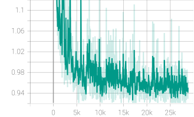
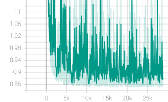

# COVID-19 病例预测（回归）：特征、学习率与网络结构实验

基于李宏毅机器学习课程 HW1，用全连接神经网络预测每日新增阳性病例比例（`tested_positive`）。
本项目重点不在刷分，而是**用控制变量法系统地分析各个因素对 validation loss 的影响**。

## 一、任务与设置

- **任务**：根据州信息和前几天的症状、行为等特征，回归预测第 3 天的 `tested_positive`。
- **损失函数**：MSE
- **基础模型**：3 层全连接网络（输入 → 16 → 8 → 1，ReLU 激活）
- **固定设置**：`batch_size=256`，`valid_ratio=0.2`，`early_stop=600`，固定随机种子
- **运行环境**：本地 CPU（无 GPU）
- **评价指标**：best valid loss（early stop 保存的最优一轮）
- **实验原则**：每次只改一个变量，其余保持不变，对比时训练轮数一致

## 二、实验结果

### 1. 特征选择的影响（500 轮）

| 实验 | 改动 | n_epochs | best valid loss | 备注 |
|---|---|---|---|---|
| baseline | 全部特征 | 500 | 4.96 | 最佳轮次 490，未收敛 |
| 特征选择 | Top_k=20 | 500 | 1.25 | 最佳轮次 498，未收敛 |

**结论**：只把全部特征减少为与目标最相关的 20 个，valid loss 从 4.96 降到 1.25，特征选择对模型影响显著。

### 2. 训练轮数的影响（全部特征）

| n_epochs | best valid loss | 备注 |
|---|---|---|
| 500 | 4.96 | 最佳轮次 490，未收敛 |
| 1000 | 2.73 | 最佳轮次 994，未收敛 |
| 3000 | 1.41 | 最佳轮次 2897，未收敛 |
| 5000 | 1.28 | 最佳轮次 4713，未收敛 |
| 8000 | 1.16 | 最佳轮次 7959，未收敛 |

**结论**：训练轮数增加，valid loss 持续下降，但每组最佳轮次都在末尾，说明学习率偏小、收敛很慢。受限于 CPU 算力，后续实验统一使用 3000 轮。

### 3. 选多少个特征（3000 轮）

| 实验 | 改动 | best valid loss | 备注 |
|---|---|---|---|
| baseline | 全部特征 | 1.41 | 最佳轮次 2897 |
| 特征选择 | Top_k=10 | 0.89 | 最佳轮次 2992 |
| 特征选择 | Top_k=15 | 0.92 | 最佳轮次 2995 |
| 特征选择 | Top_k=20 | 0.89 | 最佳轮次 2978 |
| 特征选择 | Top_k=25 | 0.89 | 最佳轮次 2998 |
| 特征选择 | Top_k=30 | 1.26 | 最佳轮次 2926 |
| 特征选择 | Top_k=40 | 1.37 | 最佳轮次 2956 |

**结论**：特征不是越多越好。按相关性排序，后面加入的特征与目标关系越来越弱，更像噪声，加得越多反而干扰模型。Top_k 在 10～25 之间效果最好（0.89 左右），后续取更简单的 **Top_k=10**。

### 4. 学习率的影响（Top_k=10，3000 轮）

| 实验 | 改动 | best valid loss | 备注 |
|---|---|---|---|
| baseline | lr=1e-5 | 0.89 | 最佳轮次 2992 |
| 学习率 | lr=1e-4 | 0.85 | 最佳轮次 2946 |
| 学习率 | lr=3e-4 | 0.85 | 最佳轮次 2279，触发 early stop |
| 学习率 | lr=1e-3 | 102.55 | 最佳轮次 6，训练发散，触发 early stop |

**结论**：lr 在 1e-4 ～ 3e-4 最优；1e-3 步长过大导致发散。3e-4 与 1e-4 效果相同，但收敛更快，后续采用 **lr=3e-4**。

### 5. 网络结构的影响（Top_k=10，lr=3e-4，3000 轮）

| 实验 | 结构 | best valid loss | 备注 |
|---|---|---|---|
| baseline | 16-8-1 | 0.85 | 最佳轮次 2279，early stop |
| 加宽 | 64-32-1 | 0.85 | 最佳轮次 576，early stop |
| 加深 | 64-32-16-1 | 0.85 | 最佳轮次 892，early stop |

**结论**：学习率调好后，加宽、加深都不能降低 valid loss，只是加快收敛，说明瓶颈在特征与数据量，而不在模型容量。

## 三、总体结论

| 因素 | 改动 | valid loss 变化 |
|---|---|---|
| 特征选择 | 全部特征 → Top_k=10（3000 轮） | 1.41 → 0.89（**影响最大**） |
| 学习率 | 1e-5 → 1e-4 / 3e-4 | 0.89 → 0.85 |
| 网络结构 | 加宽 / 加深 | 无提升（0.85） |

最终配置：**Top_k=10，lr=3e-4，结构 16-8-1，best valid loss = 0.85**。

主要收获：
1. 本任务的主要提升来自**特征选择**，而不是把模型做大。
2. 学习率过小则收敛慢，过大则发散（lr=1e-3 的实验验证了这一点）。
3. 模型容量足够时，加宽、加深只影响收敛速度，不影响最终效果。

### 训练曲线（TensorBoard）

横轴为训练步数（每个 batch 更新一次参数为一步），纵轴为 MSE loss，已做平滑处理。

|（训练损失） train loss |（验证损失） valid loss |
|---|---|
|  |  |

两条曲线在训练前期快速下降后趋于平稳：train loss 稳定在 0.95 左右，valid loss 稳定在 0.85 左右（best valid loss 为 0.85）。train loss 略高于 valid loss，是因为它是训练过程中逐 batch 累计的平均值，而 valid loss 是每个 epoch 结束后用最新参数计算的。valid loss 没有随训练继续上升，说明没有明显过拟合，与 early stop 的结果一致。

## 四、局限与后续改进

- 只用了 valid loss 比较，验证集较小，0.85 与 0.89 这类小差距可能包含随机波动；每组只跑了一次，没有多随机种子的重复实验。
- 特征选择只用了与目标的相关系数（只用训练集计算），没有考虑特征之间的冗余。
- 后续可尝试：Dropout / BatchNorm / L2 正则化、更换优化器、更好的特征选择方法，并用多个随机种子或交叉验证确认结果。

## 五、复现

1. 安装依赖：`pip install torch pandas numpy tensorboard`
2. 将 `covid_train.csv`、`covid_test.csv` 放在代码同一目录。
3. 在 `config` 中设置 `select_all=False`，在 `select_feat` 的调用处设置 `top_k`；修改 `learning_rate` 和 `n_epochs`。
4. 按顺序运行 Notebook 所有单元格（Colab 专用的下载代码需注释掉）。
